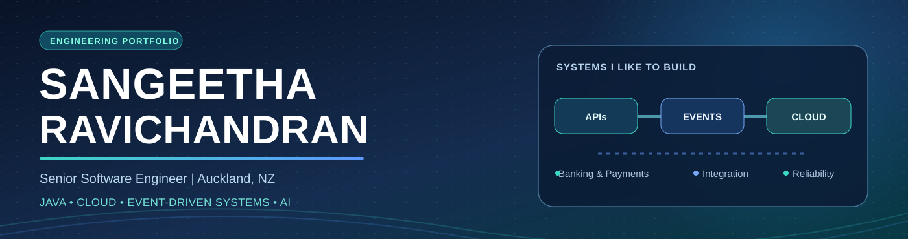
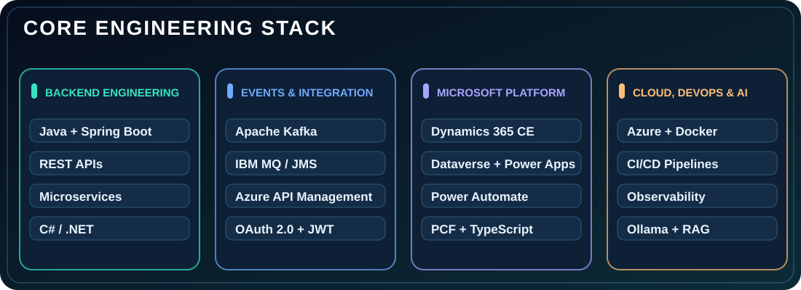
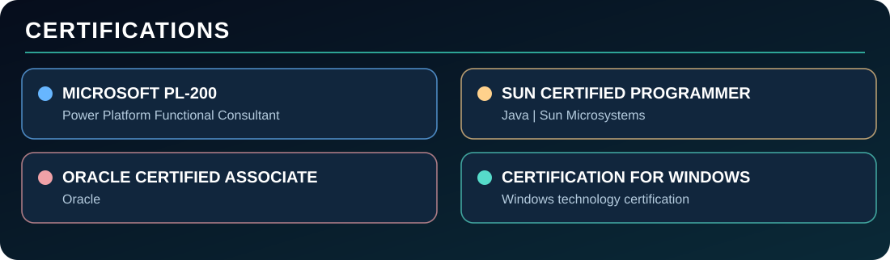

### **SENIOR SOFTWARE ENGINEER · BACKEND · CLOUD · ENTERPRISE INTEGRATION**

**Building dependable banking platforms, event-driven services and intelligent software.**

**JAVA** · **SPRING BOOT** · **KAFKA** · **IBM MQ** · **AZURE** · **DYNAMICS 365** · **AI**

---

## **👋 Hello, I'm Sangeetha**

I'm a **Senior Software Engineer** based in **Auckland, New Zealand**, with a background in **enterprise banking technology**, **backend development**, **full-stack engineering** and **complex system integration**.

I build solutions using **Java**, **Spring Boot**, **REST APIs**, **Apache Kafka**, **IBM MQ**, **Azure**, **Dynamics 365**, **Microsoft Dataverse** and **Power Platform**.

I care about **reliability, maintainability, security and clean engineering practices**, and I enjoy learning through real software projects.

### **What I build**

- **Banking & payments:** Customer services, payment workflows, fraud screening, ledger integration and messaging with core banking systems.
- **Event-driven backends:** Microservices, Kafka consumers, transactional outbox, Saga compensation, idempotency, retries and dead-letter queues.
- **Dynamics 365 & Microsoft cloud:** Dataverse Custom APIs, C# plug-ins, PCF controls, Power Automate, Azure Functions, APIM and Entra ID.
- **AI & analytics:** RAG applications, vector search, Java AI integrations, data science, machine learning and dashboards.

 

---

## **⚡ My technology stack**

| **Area** | **Tools & technologies** |
|:--|:--|
| **Backend & API engineering** | **Java**, **Spring Boot**, **Spring Framework**, **REST APIs**, **Microservices**, **JPA/Hibernate**, **C#** |
| **Messaging & reliability** | **Kafka**, **IBM MQ/JMS**, **Azure Service Bus**, **Saga**, **Transactional Outbox**, **Idempotency**, **Retry/DLQ** |
| **Microsoft platform** | **Dynamics 365 Customer Service**, **Dataverse**, **Power Apps**, **Power Automate**, **PCF**, **C# Plug-ins**, **Custom APIs** |
| **Cloud & security** | **Azure**, **AWS**, **Azure API Management**, **Entra ID**, **OAuth 2.0**, **JWT**, **Azure Functions**, **Key Vault** |
| **Frontend development** | **JavaScript**, **TypeScript**, **React**, **HTML**, **CSS** |
| **DevOps & monitoring** | **Docker**, **Kubernetes**, **GitHub Actions**, **Azure DevOps**, **GitLab CI/CD**, **Jenkins**, **Grafana**, **Splunk**, **SonarQube** |
| **Data, AI & reporting** | **PostgreSQL**, **SQL**, **Python**, **Ollama**, **RAG**, **pgvector**, **scikit-learn**, **Power BI**, **Tableau**, **Streamlit** |

---

## **🚀 Featured engineering projects**

**Architecture-driven, hands-on portfolio projects demonstrating real integration patterns.** These are personal demonstrations, not employer production source code.

### **01 · Digital Banking Payment Platform** 🏦

**[VIEW PROJECT →](https://github.com/sangeetha2402-ravichandran/Digital-Banking-Platform)**

**Stack:** **Java · Spring Boot · Kafka · IBM MQ · PostgreSQL · Docker**

A digital banking simulation with **payment initiation, fraud screening, account transfers, ledger events and core-banking request/reply integration**. Demonstrates **transactional outbox**, **Saga compensation**, **consumer idempotency**, **retry mechanisms** and **dead-letter handling**.

### **02 · Azure Banking API Integration** ☁️

**[VIEW PROJECT →](https://github.com/sangeetha2402-ravichandran/Dynamics-banking-integration-service)**

**Stack:** **Java · Spring Boot · Azure App Service · API Management · Entra ID**

Banking APIs hosted in Azure with **API gateway protection**, **OAuth 2.0 client credentials**, **JWT validation** and **application role-based access**.

### **03 · Dynamics 365 Banking Customer Service** 💼

**[VIEW PROJECT →](https://github.com/sangeetha2402-ravichandran/DynamicsBankCustomerServiceProject)**

**Stack:** **Dynamics 365 · Dataverse · C# · Power Automate · JavaScript**

An integrated banking customer service platform demonstrating **cases, queues, SLAs, transaction relationships, custom plug-ins, automation** and a **Canvas App**.

### **04 · PCF Customer Transactions + Azure Functions** 🧩

**[PCF CONTROL →](https://github.com/sangeetha2402-ravichandran/PCF-CustomerTransactionsControl)** · **[AZURE FUNCTIONS →](https://github.com/sangeetha2402-ravichandran/Azure-Functions-Bank)**

**Stack:** **React · TypeScript · PCF · Dataverse Custom APIs · Azure Functions**

A custom **Power Apps Component Framework control** communicating through a **Dataverse Custom API**, with separate **Azure integration components**.

### **05 · Dynamics 365 ALM & CI/CD** 🔁

**[VIEW PROJECT →](https://github.com/sangeetha2402-ravichandran/Dynamics365-CustomerService-ALM)**

**Stack:** **C# · Power Platform CLI · Azure DevOps · CI/CD**

A practical example of **plug-in development, managed solution packaging, environment configuration** and **controlled deployment pipelines**.

### **06 · Spring Boot RAG with Ollama** 🤖

**[VIEW PROJECT →](https://github.com/sangeetha2402-ravichandran/SpringBoot-RAG-Ollama-PGVector)**

**Stack:** **Java · Spring Boot · Ollama · PostgreSQL · pgvector**

A **retrieval-augmented generation (RAG)** prototype using **document embeddings**, **vector similarity search** and **local LLM responses**.

---

## **📊 AI, machine learning & analytics projects**

| **Project** | **What it demonstrates** |
|:--|:--|
| **[Customer Churn Prediction](https://github.com/sangeetha2402-ravichandran/ChurnPrediction-RF-XGBoost-EBM)** | **Random Forest, XGBoost and Explainable Boosting Machine** comparison |
| **[OpenAI Java](https://github.com/sangeetha2402-ravichandran/OpenAIJava)** | **OpenAI Java SDK** integration with Maven |
| **[Stock Market Analytics](https://github.com/sangeetha2402-ravichandran/StockMarketAnalytics-StreamLitDashboard)** | **Streamlit**, moving averages, returns and interactive charts |
| **[IPL Data Analysis](https://github.com/sangeetha2402-ravichandran/Indian-Premier-League-IPL-Data-Analysis-Project)** | **Python**, exploratory cricket analytics and visualisation |
| **[ESPN Cricket Power BI](https://github.com/sangeetha2402-ravichandran/PowerBI--ESPN-Cricket-Data-Analysis)** | **Power BI** data modelling and interactive reporting |
| **[NZ Transport Dashboard](https://github.com/sangeetha2402-ravichandran/NZ-Transport-Dashboard)** | **Spring Boot**, **WebSocket** and **STOMP** |

### **[EXPLORE ALL MY GITHUB REPOSITORIES →](https://github.com/sangeetha2402-ravichandran?tab=repositories)**

---

## **🎓 Education**

**Master of Information Technology in Data Science**  
**Whitecliffe College, Auckland, New Zealand** · **NZ Level 9** · **Completed with Merit, July 2026**

**Master of Engineering in Multimedia Technology**  
**College of Engineering, Anna University, India** · **GPA 8.2**

**Bachelor of Engineering in Computer Science**  
**R.M.D. Engineering College, Anna University, India** · **GPA 8.2**

---

## **🏅 Professional certifications**

- **Microsoft PL-200** — **Power Platform Functional Consultant**.
- **Sun Certified Programmer for Java** — **Sun Microsystems**.
- **Oracle Certified Associate** — **Oracle**.
- **Certification for Windows** — **Windows technology certification**.

---

## **🏆 Professional recognition**

Recognition received during engineering work at **Bank of New York Mellon Technology**:

- **Incredible Awards** — **ALC Project** and **Production Support**.
- **GEM Award** — **Direct Access Project**.
- **Rain Maker Award** — **Account Updater NRP**.
- **Client Commendation** — **Direct Access Project**.
- **Recognition for resolving critical SonarQube blocker issues**.

---

### **🤝 Let's connect**

**Interested in Java engineering, banking systems, enterprise integration, Microsoft Dynamics 365, Azure and practical AI?**

**BUILD CLEARLY · INTEGRATE SECURELY · DELIVER RELIABLY**

